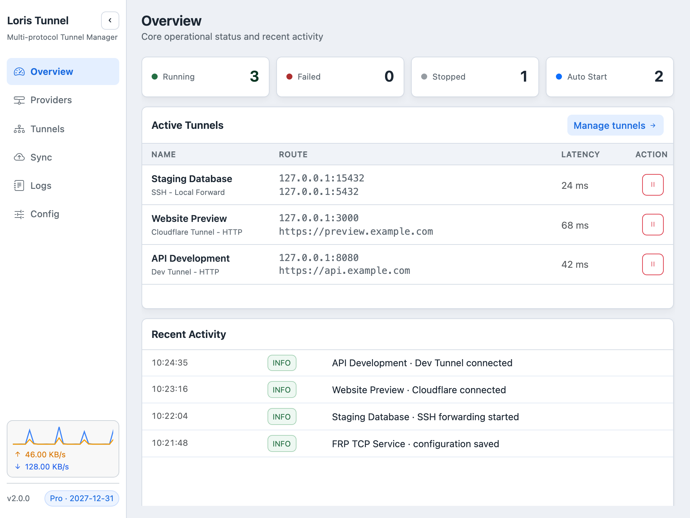
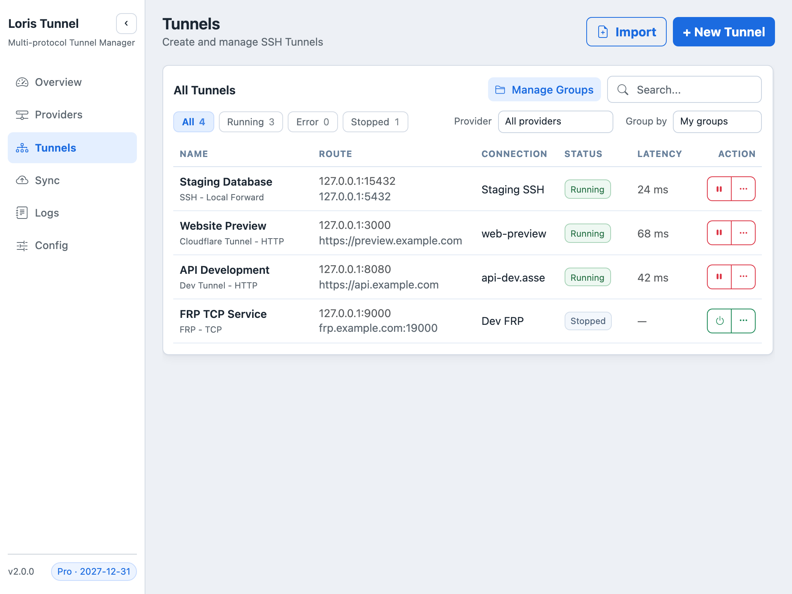
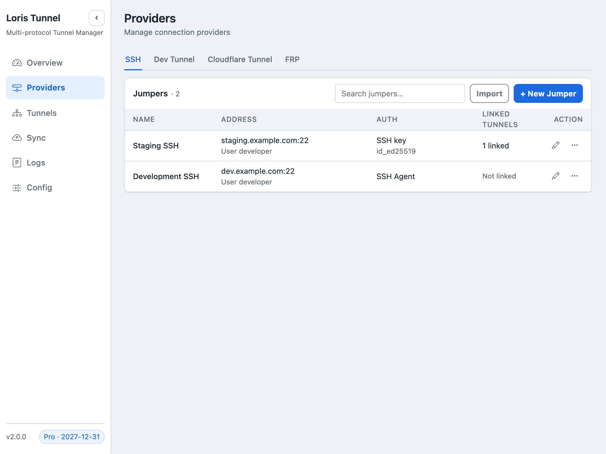
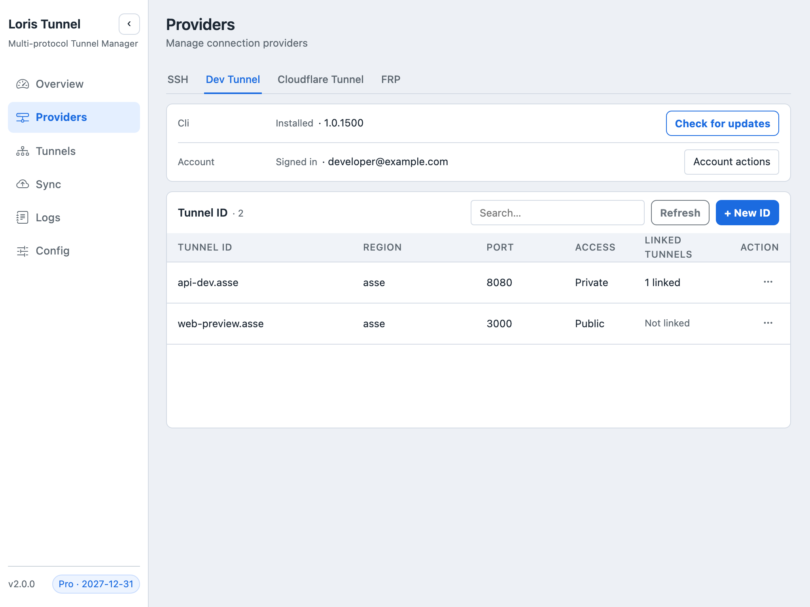
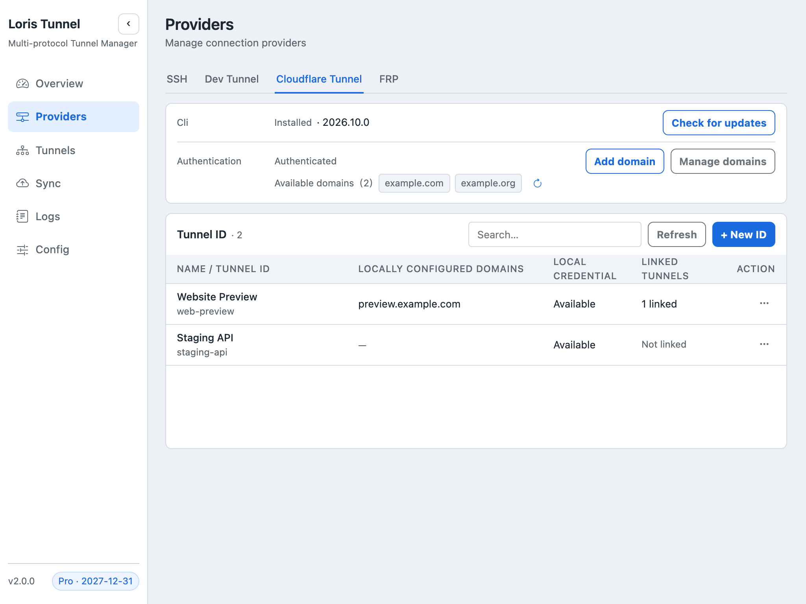
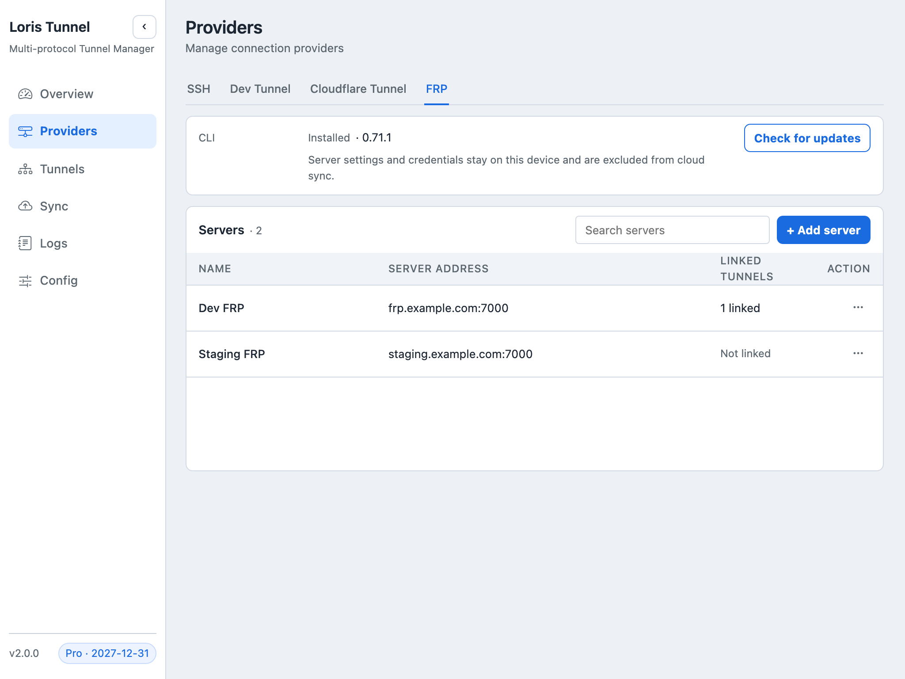
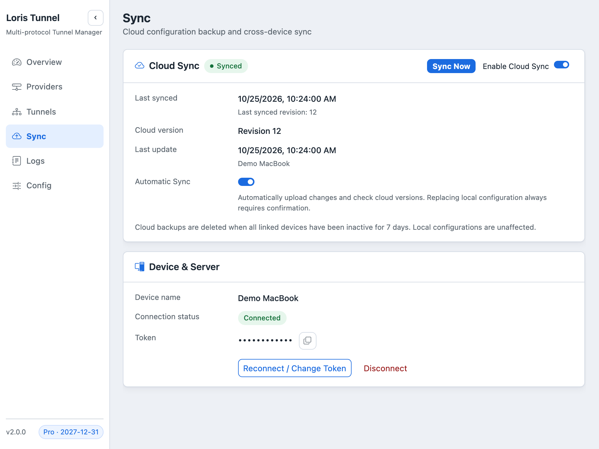
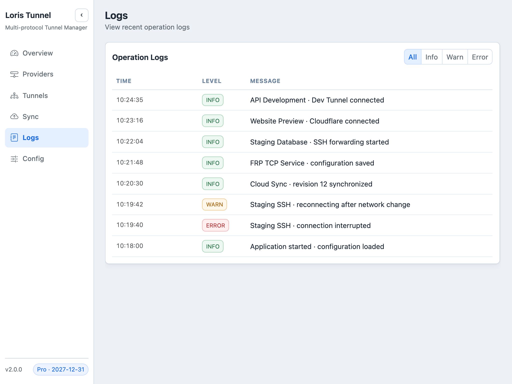
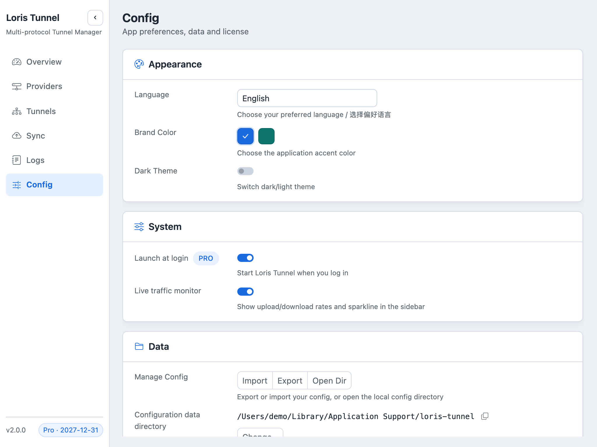

# Loris Tunnel

<div align="center">

[English](README.md)

**支持 SSH、Dev Tunnel、Cloudflare 和 FRP 的桌面隧道管理工具**

在 macOS 和 Windows 上集中管理连接、发布本地服务并监控隧道状态。

<a href="https://apps.microsoft.com/detail/9nsmf69f8kdt">
  
</a>


</div>

## 项目简介

Loris Tunnel 将 SSH 端口转发和本地服务发布集中到一个图形工作区。你可以按分组组织隧道、配置 Provider，并查看连接状态、延迟、流量和日志。

本文描述当前源码分支的能力。已发布安装包可能包含较早的功能，请以所安装版本的发布说明为准。



## 截图

以下截图使用演示数据，并展示 Pro 示例状态，不代表实时连接结果或免费版限制。

| 隧道管理 | SSH 跳板机 |
| --- | --- |
|  |  |
| 按分组和 Provider 管理隧道。 | 管理认证方式和关联隧道。 |

| Dev Tunnel | Cloudflare |
| --- | --- |
|  |  |
| 管理 CLI 安装、登录及隧道资源。 | 管理域名区域授权和命名隧道。 |

| FRP | 云备份 |
| --- | --- |
|  |  |
| 配置 FRP 客户端与服务器连接。 | 查看备份版本、设备和连接状态。 |

| 日志 | 设置 |
| --- | --- |
|  |  |
| 查看连接事件、警告和错误。 | 配置外观、启动行为和数据管理。 |

现有截图工作流见[截图说明](screenshots/README.md)。

## 功能特性

- **四种 Provider** — SSH、Microsoft Dev Tunnel、Cloudflare Tunnel 和 FRP 客户端。
- **隧道管理** — 创建、编辑、复制、分组，以及独立启动和停止隧道。
- **连接恢复** — 自动重连、可选的隧道自动启动；应用开机启动单独配置。
- **SSH 工具** — 本地、远程和 SOCKS5 转发，多跳跳板机，SSH 命令和 SSH 配置导入，连接测试及 SSH 线路延迟对比。
- **运行监控** — 连接状态、延迟、流量监控和活动日志；具体指标取决于 Provider。
- **云备份与恢复** — 有效 Pro 授权可备份配置文件并恢复云端版本；自动备份默认关闭。
- **桌面偏好** — 浅色和深色主题，英文、简体中文、繁体中文（台湾和香港）及俄文界面。

| Provider | 用途 | 前置条件 | 典型场景 |
| --- | --- | --- | --- |
| SSH | 本地、远程端口转发和动态 SOCKS5 代理 | SSH 服务器，以及密码、私钥或 SSH Agent | 数据库、内网服务和跳板机 |
| Dev Tunnel | 发布本机回环地址上的服务 | 官方 Dev Tunnel CLI，GitHub 或 Microsoft 登录 | 开发预览和服务分享 |
| Cloudflare | 通过命名隧道及域名发布 HTTP/HTTPS 源站 | `cloudflared`、Cloudflare 授权及托管在 Cloudflare 的域名 | 使用固定域名访问本地 Web 服务 |
| FRP | TCP 端口映射或 HTTP 域名路由 | `frpc` 和已有的 `frps` 服务器 | 使用自有 FRP 基础设施发布服务 |

## 快速开始

### 下载安装

- **Windows**：通过 [Microsoft Store](https://apps.microsoft.com/detail/9nsmf69f8kdt?hl=en-US&gl=US) 安装，或从 [Releases](../../releases) 下载 `.exe` 安装包。
- **macOS**：从 [Releases](../../releases) 下载 `.dmg` 安装包。

### 创建第一条隧道

1. 打开 **Providers**，选择 SSH、Dev Tunnel、Cloudflare 或 FRP。
2. 根据类型添加 SSH 跳板机、安装并授权 Provider CLI，或配置 FRP 服务器。
3. 打开 **Tunnels**，创建隧道，选择 Provider 并填写转发或本地服务参数。
4. 启动隧道并查看状态和日志。发布服务时，确认返回的访问地址，并从预期客户端测试。

本地服务可达、隧道运行和公网地址可访问是不同的检查结果。地址预览本身不能证明公网可访问；Private Dev Tunnel 还需要访问者身份认证。

### macOS 首次打开

如果 macOS 阻止打开下载的应用，且你确认来源可信，可取消提示，然后进入 **系统设置 → 隐私与安全性**，为 Loris Tunnel 选择“仍要打开”。

也可以在应用安装于以下路径时执行：

```bash
sudo xattr -rd com.apple.quarantine /Applications/loris-tunnel.app
```

## Provider 使用说明

### SSH

在 **Providers → SSH** 中添加跳板机，选择密码、SSH Key 或 SSH Agent 认证。创建隧道时选择一个或多个跳板机；多个跳板机按顺序组成连接链。也可通过界面导入 SSH 命令（`-L`、`-R`、`-D`）或 SSH 配置条目。

| 模式 | 行为 |
| --- | --- |
| `local` | 在本机监听，将连接转发到 SSH 服务器可访问的目标地址 |
| `remote` | 在 SSH 服务器监听，将连接转发到本机可访问的目标地址 |
| `socks5` | 将 SSH 连接作为动态 SOCKS5 代理 |

### Dev Tunnel

在 **Providers → Dev Tunnel** 安装官方 CLI，使用 GitHub 或 Microsoft 登录，然后在 **Tunnels** 创建或绑定隧道。CLI 按需安装，不包含在桌面安装包中。

- 每条隧道发布 `127.0.0.1`、`localhost` 或 `::1` 上的一个服务。
- 访问权限默认为 **Private**。选择 **Public** 会允许匿名访问，请仅发布适合该访问范围的服务。
- 访问地址以运行中的 CLI 返回结果为准。登录凭据保存在 CLI／系统凭据存储中，不写入 TOML 或云备份。

### Cloudflare

在 **Providers → Cloudflare** 安装 `cloudflared`，在浏览器中完成相应 Cloudflare 域名区域的授权，然后在 **Tunnels** 创建或绑定命名隧道并设置访问域名。

- 支持 HTTP 和 HTTPS 源站。域名需托管在 Cloudflare，所选区域需具有授权，并配置相应 DNS 路由。
- 证书、域名区域授权文件和隧道凭据保留在 `~/.cloudflared` 下；复制 TOML 中的隧道设置不会复制这些凭据。
- 在其他设备使用配置前，需完成 Cloudflare 授权并准备相应隧道的本地凭据。需要身份认证的服务还应单独设置访问者权限。

### FRP

在 **Providers → FRP** 安装官方 `frpc` 或选择本机可执行文件，再添加已有 FRP 服务器。Loris Tunnel 不部署或管理 `frps`。

- TCP 源站地址示例为 `tcp://127.0.0.1:3000`，HTTP 为 `http://127.0.0.1:3000`；不支持本地 HTTPS 源站。
- 配置服务器暴露的 TCP 端口，或 HTTP 域名、DNS 及 `frps` HTTP 入口端口。代理名需在服务器的用户命名空间内唯一。
- 服务器 Token 用于认证 FRP 客户端；访问者身份认证由发布的服务负责。
- 服务器设置和 Token 保存在应用配置目录的 `frp-local.json`，使用当前用户专属文件权限，不参与普通导出或云备份。其他设备需单独配置服务器并重新绑定。
- 客户端管理 API 确认代理注册后才显示运行中；本地源站可达性单独展示。

## 免费版与 Pro

| 能力 | 免费版 | 有效 Pro 授权 |
| --- | --- | --- |
| 跨所有 Provider 的同时运行隧道数 | 3 条 | 无应用内并发数量限制 |
| 云备份与恢复 | 不可用 | 可用 |

正在启动和重连的隧道也计入并发名额，自动启动同样受限。授权校验失败时，启动隧道按免费版限制处理。Provider 服务配额和服务器容量仍独立生效。可在 **Config** 管理授权。

## 配置与备份

### 配置文件位置

- **开发模式（`wails dev`）**：工作目录可写时使用 `./config.toml`，否则使用 `~/.loris-tunnel/config.toml`。
- **安装版本**：默认使用 `~/.loris-tunnel/config.toml`。
- **自定义目录**：在 **Config** 修改。默认配置目录中的 `config.root` 文件以绝对路径指向实际配置目录；目标无效或不可用时回退到默认位置。

配置文件不存在或为空时会在启动时初始化。日常修改建议使用界面完成。

### 最小 SSH 示例

以下 SSH 服务器为占位地址，请替换主机和用户名，并向 SSH Agent 加载有效密钥。本机 `15432` 端口将转发到 SSH 服务器回环地址的 `5432` 端口。

```toml
version = 1

[[jumpers]]
id = 1
name = "example-server"
host = "ssh.example.com"
port = 22
user = "ubuntu"
auth_type = "ssh_agent"

[[tunnels]]
id = 1
name = "local-db"
provider = "ssh"
mode = "local"
jumper_ids = [1]
local_host = "127.0.0.1"
local_port = 15432
remote_host = "127.0.0.1"
remote_port = 5432
auto_start = false
```

`auth_type` 支持 `ssh_agent`、`ssh_key`（搭配 `key_path`）和 `password`（搭配 `password`）。`jumper_ids` 按连接顺序引用跳板机 ID。

### 导出与云备份范围

- **普通导出**：序列化 TOML 配置，排除内部云同步基线。导出内容可能包含 SSH 密码、私钥路径和注册码，应按敏感文件保管。
- **云备份**：上传实际使用的完整 `config.toml`，包含注释、密码、私钥路径和授权字段。通过 HTTPS 上传，服务端加密保存；不属于客户端端到端加密。自动备份默认关闭，恢复版本需要确认。
- **两者均不打包**：私钥文件、Dev Tunnel 登录凭据、`~/.cloudflared` 凭据、FRP 服务器设置与 Token、日志及 `config.root` 指针。云连接设置使用 `sync.dev.json` 或 `sync.prod.json`；云 Token 保存在 macOS Keychain 或 Windows Credential Manager。

在其他电脑恢复后，需检查路径、本地端口、Provider 登录、凭据和 FRP 服务器绑定。详细行为见[云备份说明](docs/cloud-sync.md)。

## 从源码构建

在本仓库的本地检出目录执行以下命令。

- **Go ≥ 1.26.0**；`go.mod` 指定工具链 **go1.26.9**。
- **Node.js ≥ 18** 和 **pnpm**，用于前端。
- **Wails CLI v2.16.0**，与后端依赖一致；平台构建依赖以 `wails doctor` 检查结果为准。

```bash
# 从仓库根目录开始
go install github.com/wailsapp/wails/v2/cmd/wails@v2.16.0
cd frontend
pnpm install --frozen-lockfile
cd ..
wails doctor

# 开发模式
wails dev

# 生产构建（输出到 build/bin）
wails build
```

| 层 | 技术 |
| --- | --- |
| 桌面框架 | Wails v2.16.0 |
| 后端 | Go |
| 前端 | Vue 3、Vite、Bootstrap、vue-i18n |
| SSH | Go `golang.org/x/crypto/ssh` |
| 其他 Provider | 官方 Dev Tunnel、cloudflared 和 frpc CLI |

## 相关文档

- [开发说明](docs/DEV_NOTES.md)
- [后端 API](docs/BACKEND_API.md)
- [隧道故障诊断](docs/TUNNEL_FAILURE_DIAGNOSIS.md)
- [云备份部署与行为](docs/cloud-sync.md)
- [发布指南](docs/RELEASE_GUIDE.md)

## 社区交流

- **QQ 交流群**：**1009737419**
- **联系邮箱**：[yang.rangerwolf@gmail.com](mailto:yang.rangerwolf@gmail.com)

## 开源协议

[Apache License 2.0](LICENSE)。
