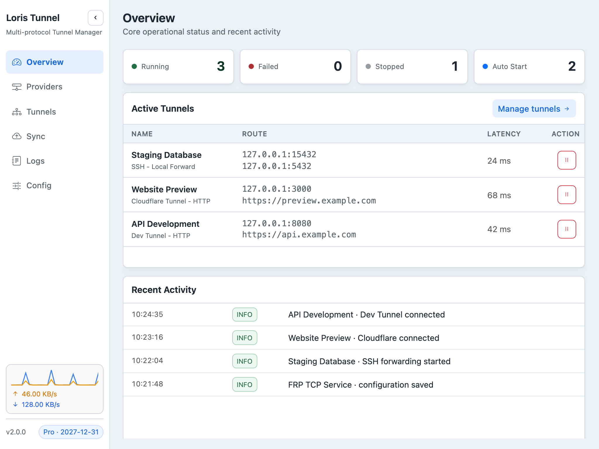
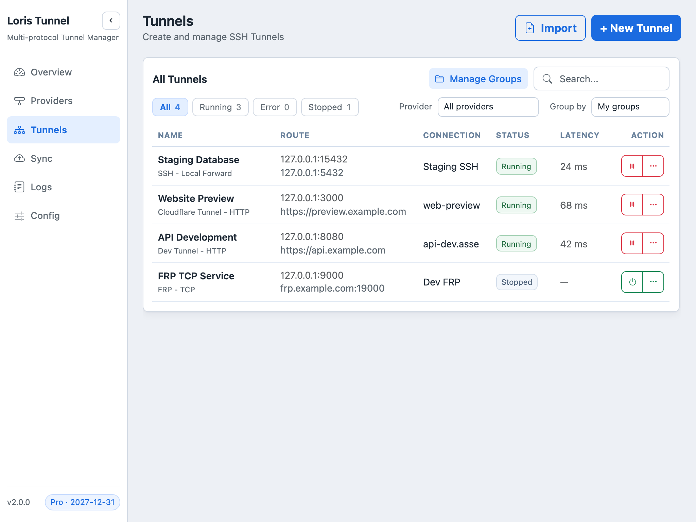
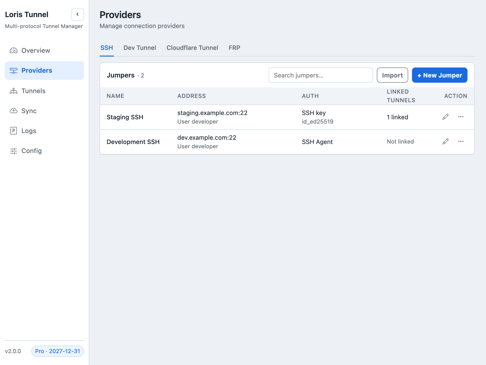
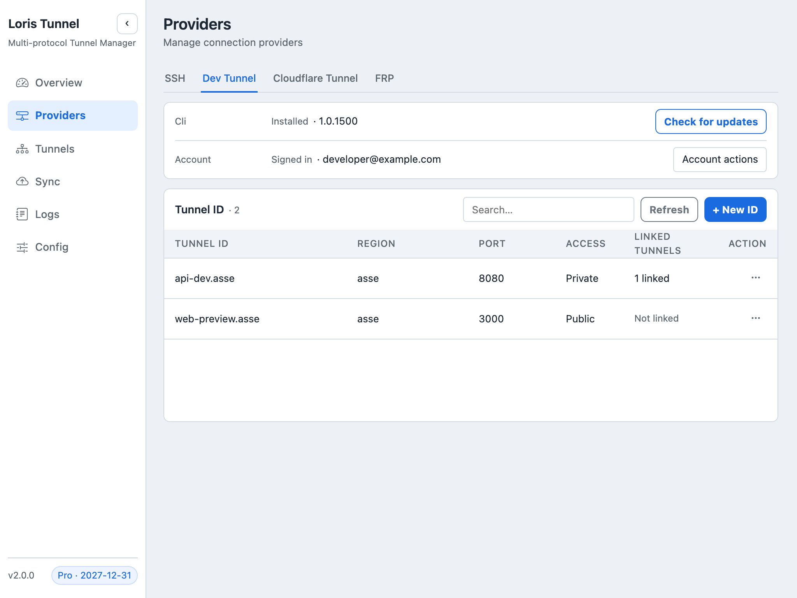
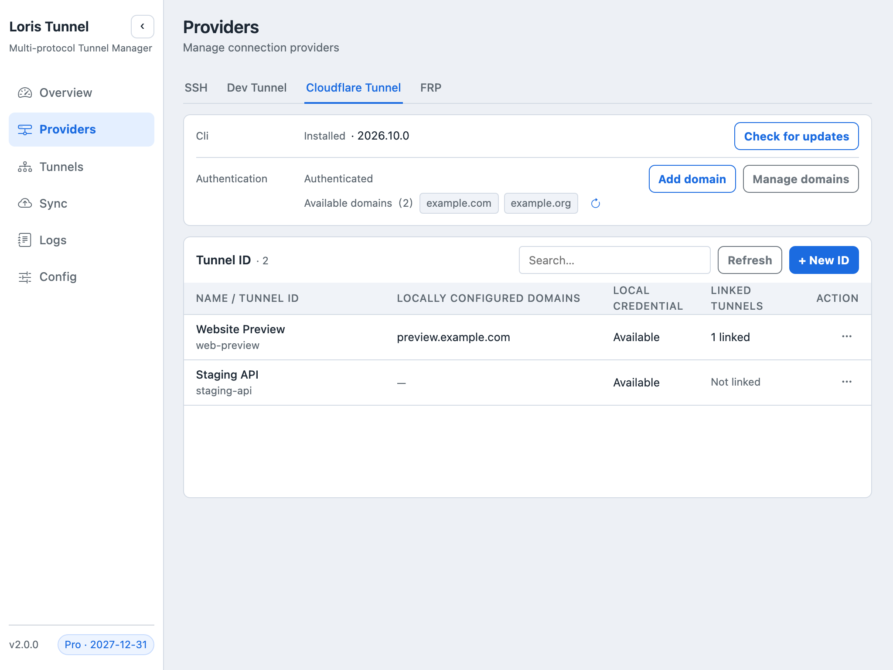
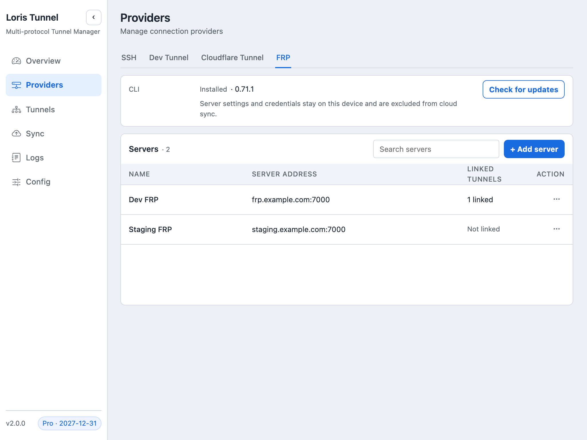
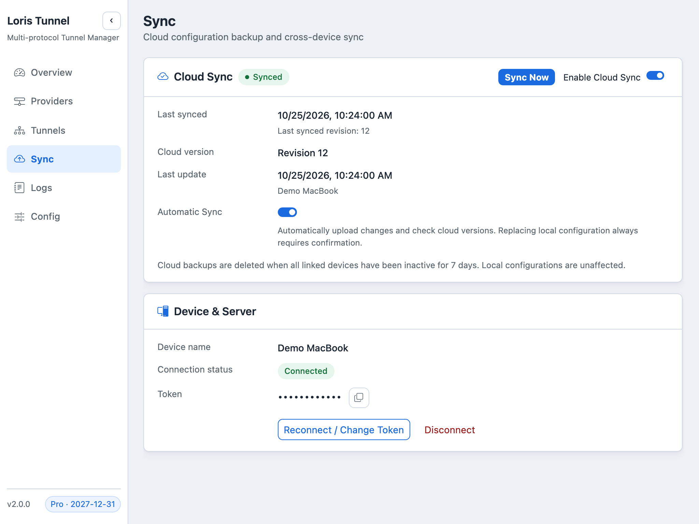
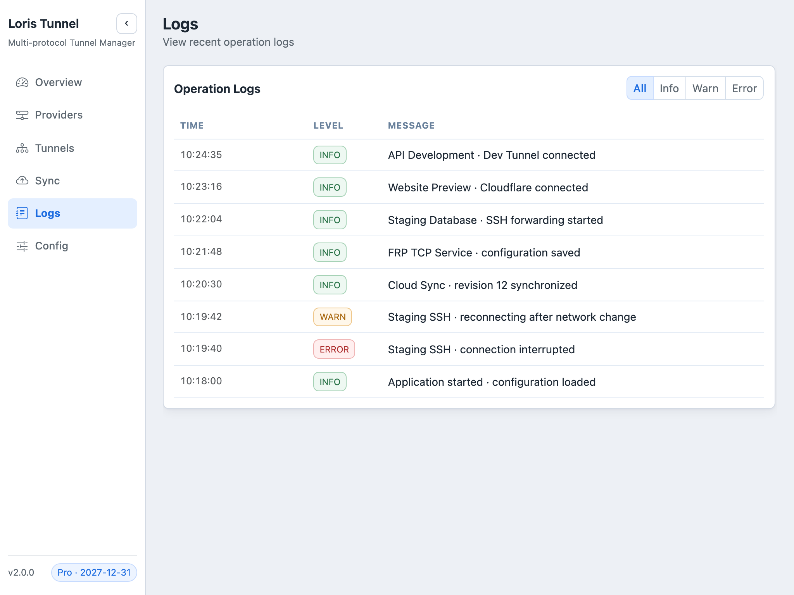
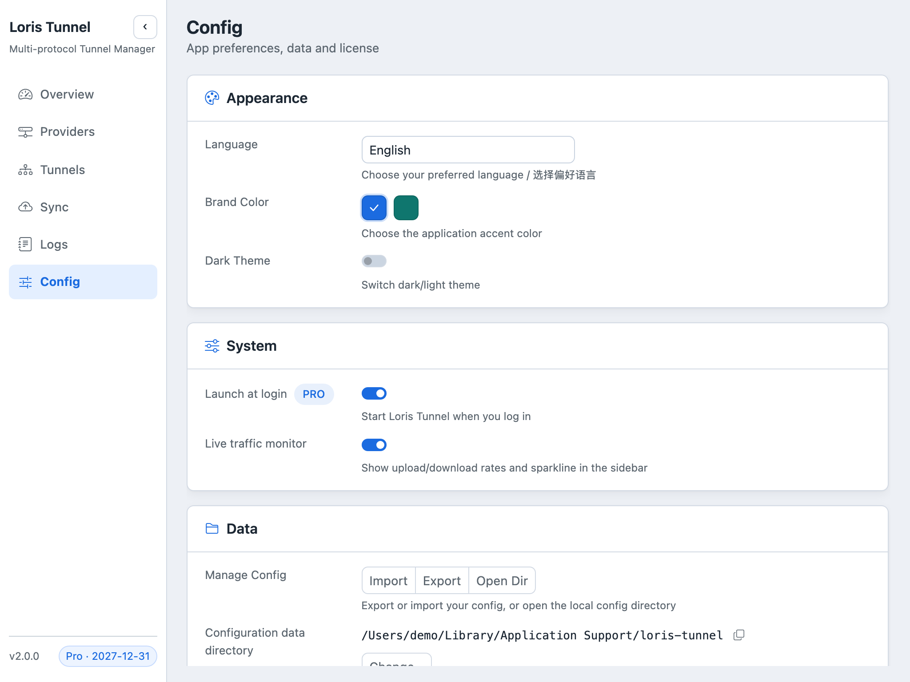

# Loris Tunnel

<div align="center">

[简体中文](README.CN.md)

**A desktop tunnel manager for SSH, Dev Tunnel, Cloudflare, and FRP**

Manage connections, expose local services, and monitor tunnels on macOS and Windows.

<a href="https://apps.microsoft.com/detail/9nsmf69f8kdt">
  
</a>


</div>

## Overview

Loris Tunnel brings SSH forwarding and local service publishing into one graphical workspace. Organize tunnels into groups, manage provider connections, and inspect connection status, latency, traffic, and logs.

This README describes the current source branch. Published installers may contain an earlier feature set; check the release notes for your installed version.



## Screenshots

These screenshots use demonstration data and show a Pro example state; they do not represent live connections or the free plan's limits.

| Tunnel management | SSH jump hosts |
| --- | --- |
|  |  |
| Organize tunnels by group and provider. | Manage authentication and associated tunnels. |

| Dev Tunnel | Cloudflare |
| --- | --- |
|  |  |
| Manage CLI installation, sign-in, and tunnel resources. | Manage zone authorizations and named tunnels. |

| FRP | Cloud backup |
| --- | --- |
|  |  |
| Configure the FRP client and server connections. | View backup versions, devices, and connection status. |

| Logs | Settings |
| --- | --- |
|  |  |
| Inspect connection events, warnings, and errors. | Customize appearance, startup, and data management. |

See [screenshot documentation](screenshots/README.md) for the existing capture workflow.

## Features

- **Four providers** — SSH, Microsoft Dev Tunnel, Cloudflare Tunnel, and FRP client.
- **Tunnel management** — create, edit, duplicate, group, start, and stop tunnels independently.
- **Connection recovery** — automatic reconnection and optional tunnel auto-start; launch at login is configured separately.
- **SSH tools** — local, remote, and SOCKS5 forwarding, multi-hop jump hosts, SSH command and SSH config import, connection testing, and SSH route latency comparison.
- **Monitoring** — connection status, latency, traffic monitoring, and activity logs, with availability depending on the provider.
- **Cloud backup and restore** — back up the configuration file and restore cloud versions with an active Pro license; automatic backup is off by default.
- **Desktop preferences** — light and dark themes; English, Simplified Chinese, Traditional Chinese (Taiwan and Hong Kong), and Russian interfaces.

| Provider | Purpose | Requirements | Typical use |
| --- | --- | --- | --- |
| SSH | Local/remote port forwarding and dynamic SOCKS5 proxy | An SSH server and password, private key, or SSH agent | Databases, internal services, and jump hosts |
| Dev Tunnel | Publish a local loopback service | Official Dev Tunnel CLI and GitHub or Microsoft sign-in | Development previews and service sharing |
| Cloudflare | Publish an HTTP/HTTPS origin through a named tunnel and hostname | `cloudflared`, Cloudflare authorization, and a domain managed in Cloudflare | A local web service with a stable hostname |
| FRP | TCP port mapping or HTTP domain routing | `frpc` and an existing `frps` server | Publishing through your own FRP infrastructure |

## Quick Start

### Download

- **Windows**: [Microsoft Store](https://apps.microsoft.com/detail/9nsmf69f8kdt?hl=en-US&gl=US), or the `.exe` installer from [Releases](../../releases).
- **macOS**: the `.dmg` installer from [Releases](../../releases).

### First Tunnel

1. Open **Providers** and select SSH, Dev Tunnel, Cloudflare, or FRP.
2. Add an SSH jump host, install and authorize a provider CLI, or configure an FRP server as appropriate.
3. Open **Tunnels**, create a tunnel, choose the provider, and enter its forwarding or local service settings.
4. Start the tunnel and inspect its status and logs. For published services, check the reported address and test it from the intended client.

A reachable local service, a running tunnel, and a publicly reachable endpoint are separate checks. An address preview alone does not confirm public access; private Dev Tunnels also require visitor authentication.

### First Launch on macOS

If macOS blocks the downloaded app and you trust its source, cancel the warning, then open **System Settings → Privacy & Security → Open Anyway** for Loris Tunnel.

Alternatively, if the app is installed at the path below:

```bash
sudo xattr -rd com.apple.quarantine /Applications/loris-tunnel.app
```

## Provider Guide

### SSH

Add jump hosts under **Providers → SSH** using password, SSH key, or SSH agent authentication. Select one or more jump hosts when creating a tunnel; multiple hosts form an ordered jump chain. You can also import an SSH command (`-L`, `-R`, or `-D`) or SSH config entries through the UI.

| Mode | Behavior |
| --- | --- |
| `local` | Forward a local listening address to a destination reached from the SSH server |
| `remote` | Listen on the SSH server and forward to a destination reached from this computer |
| `socks5` | Use the SSH connection as a dynamic SOCKS5 proxy |

### Dev Tunnel

Install the official CLI from **Providers → Dev Tunnel**, sign in with GitHub or Microsoft, then create or bind a tunnel from **Tunnels**. CLI installation is on demand; it is not bundled with the desktop app.

- Each tunnel exposes one service on `127.0.0.1`, `localhost`, or `::1`.
- Access defaults to **Private**. Choosing **Public** allows anonymous visitors; only publish services intended for that audience.
- Use the URL reported by the running CLI. Login tokens remain in the CLI/system credential store, outside the TOML configuration and cloud backup.

### Cloudflare

Install `cloudflared` under **Providers → Cloudflare**, complete browser authorization for the relevant Cloudflare zone, then create or bind a named tunnel and configure its hostname in **Tunnels**.

- Supports HTTP and HTTPS origins. The domain must be managed in Cloudflare, with authorization for the selected zone and an appropriate DNS route.
- Certificates, zone authorization files, and tunnel credentials remain under `~/.cloudflared`; copying a tunnel's TOML settings does not copy those credentials.
- On another device, authorize Cloudflare and provide the required local tunnel credentials before starting the copied configuration. Configure visitor access separately for services that need authentication.

### FRP

Install the official `frpc` or select a local executable under **Providers → FRP**, then add an existing FRP server. Loris Tunnel does not deploy or manage `frps`.

- TCP origins use addresses such as `tcp://127.0.0.1:3000`; HTTP origins use `http://127.0.0.1:3000`. Local HTTPS origins are not supported.
- Configure the server's exposed TCP port, or the HTTP hostname, DNS, and `frps` HTTP entry port. Proxy names must be unique within the server's user namespace.
- Server tokens authenticate the FRP client; visitor authentication belongs to the published service.
- Server settings and tokens are stored in `frp-local.json` beside the app configuration with current-user-only permissions. They are excluded from ordinary exports and cloud backup; configure and rebind the server on each additional device.
- Running status requires confirmation from the client management API. Local origin reachability is displayed separately.

## Free and Pro

| Capability | Free | Active Pro license |
| --- | --- | --- |
| Concurrent tunnels, across all providers | 3 | No application-imposed concurrency limit |
| Cloud backup and restore | Unavailable | Available |

Starting and reconnecting tunnels count toward the concurrent limit, including automatic starts. If license verification fails, tunnel starts use the free limit. Provider service quotas and server capacity still apply independently. Manage the license under **Config**.

## Configuration and Backup

### Configuration Location

- **Development (`wails dev`)**: `./config.toml` when the working directory is writable; otherwise `~/.loris-tunnel/config.toml`.
- **Installed builds**: `~/.loris-tunnel/config.toml` by default.
- **Custom directory**: change it under **Config**. A `config.root` file in the default configuration directory points to the effective directory using an absolute path. An invalid or unavailable target falls back to the default location.

An absent or empty configuration file is initialized on startup. Prefer the UI for everyday changes.

### Minimal SSH Example

The SSH server below is a placeholder. Replace its host and user and load a valid key into your SSH agent. The local port `15432` forwards to port `5432` on the SSH server's loopback interface.

```toml
version = 1

[[jumpers]]
id = 1
name = "example-server"
host = "ssh.example.com"
port = 22
user = "ubuntu"
auth_type = "ssh_agent"

[[tunnels]]
id = 1
name = "local-db"
provider = "ssh"
mode = "local"
jumper_ids = [1]
local_host = "127.0.0.1"
local_port = 15432
remote_host = "127.0.0.1"
remote_port = 5432
auto_start = false
```

Supported `auth_type` values are `ssh_agent`, `ssh_key` (with `key_path`), and `password` (with `password`). `jumper_ids` references jump host IDs, in connection order.

### Export and Cloud Backup Boundaries

- **Ordinary export** serializes the TOML configuration and removes internal cloud-sync baselines. It can contain SSH passwords, private key paths, and the license code; handle exported files as sensitive data.
- **Cloud backup** uploads the effective `config.toml` as a whole, including comments, passwords, key paths, and license fields. Uploads use HTTPS and the server encrypts stored backups; this is not client-side end-to-end encryption. Automatic backup is off by default, and restoring a version requires confirmation.
- **Outside both**: private key files, Dev Tunnel login credentials, `~/.cloudflared` credentials, FRP server settings/tokens, logs, and the `config.root` pointer are not bundled. Cloud connection settings use `sync.dev.json` or `sync.prod.json`; the cloud token stays in macOS Keychain or Windows Credential Manager.

Restoring on another computer requires checking paths, local ports, provider sign-in, credentials, and FRP server bindings. See [cloud backup details](docs/cloud-sync.md).

## Build from Source

Run these commands from a checkout of this repository.

- **Go ≥ 1.26.0**; `go.mod` specifies toolchain **go1.26.9**.
- **Node.js ≥ 18** and **pnpm** for the frontend.
- **Wails CLI v2.16.0**, matching the backend dependency, plus the platform build prerequisites reported by `wails doctor`.

```bash
# From the repository root
go install github.com/wailsapp/wails/v2/cmd/wails@v2.16.0
cd frontend
pnpm install --frozen-lockfile
cd ..
wails doctor

# Development
wails dev

# Production build (output: build/bin)
wails build
```

| Layer | Technology |
| --- | --- |
| Desktop | Wails v2.16.0 |
| Backend | Go |
| Frontend | Vue 3, Vite, Bootstrap, vue-i18n |
| SSH | Go `golang.org/x/crypto/ssh` |
| Additional providers | Official Dev Tunnel, cloudflared, and frpc CLIs |

## Documentation

- [Development notes](docs/DEV_NOTES.md)
- [Backend API](docs/BACKEND_API.md)
- [Tunnel failure diagnosis](docs/TUNNEL_FAILURE_DIAGNOSIS.md)
- [Cloud backup deployment and behavior](docs/cloud-sync.md)
- [Release guide](docs/RELEASE_GUIDE.md)

## Community

- **QQ group**: **1009737419**
- **Email**: [yang.rangerwolf@gmail.com](mailto:yang.rangerwolf@gmail.com)

## License

[Apache License 2.0](LICENSE).
